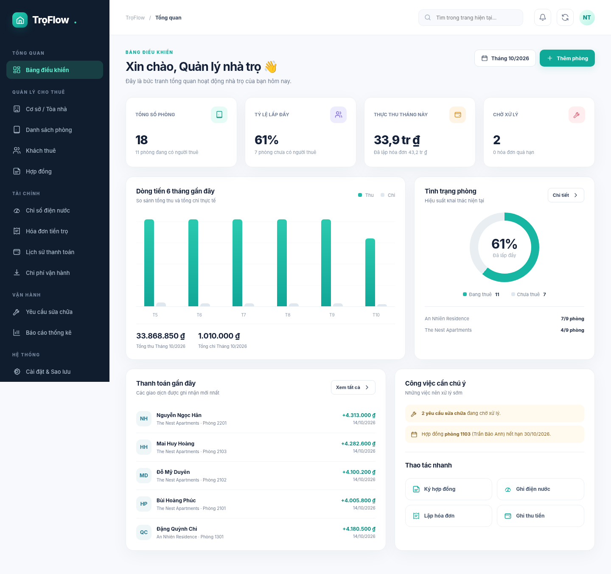

> **Cập nhật V5.1 (mẫu hóa đơn chi tiết và in A4):** xem [README-V5.1.md](README-V5.1.md). Không thay đổi database.

# TrọFlow 5.0

**Hướng dẫn nâng cấp V5:** xem [README-V5.md](README-V5.md). Dự án giữ đầy đủ tính năng V1–V4 và hỗ trợ Docker/Portainer/GitHub Actions.

---

# TrọFlow 4.0 — bản mới nhất

**Đọc [README-V4.md](README-V4.md) trước khi cập nhật**. Gồm tính năng, migration, quyền, ảnh, Stack, GHCR và QA staging.

---

# TrọFlow — Web quản lý nhà trọ chạy bằng Docker

> **TrọFlow 3.0** (phân quyền 79 thao tác, chỉ số điện nước theo năm, tiền thuê trả trước nhiều tháng): xem [README-V3.md](README-V3.md). Portainer dùng `PORT=8088` hoặc cổng host tùy chọn; dữ liệu vẫn trong `/opt/troflow/`.

> **TrọFlow 2.0 (đã nâng cấp 12 phân hệ):** xem [README-V2.md](README-V2.md) để biết thiết kế, chức năng mới, migration và các bước nâng cấp dữ liệu. Đăng nhập tại `/`, vào trang **TrọFlow Nâng cao** (`/advanced`). Bản Portainer hiện lưu dữ liệu ở `/opt/troflow/data`, backup ở `/opt/troflow/backups`, ảnh ở `/opt/troflow/uploads`.



**TrọFlow** là ứng dụng quản lý nhà trọ self-hosted, giao diện tiếng Việt, responsive trên điện thoại và máy tính. Một container chạy cả web UI và API; dữ liệu dùng SQLite (WAL) và được lưu trong Docker volume. Múi giờ mặc định **Asia/Ho_Chi_Minh** (có thể đổi qua `.env`).

## Triển khai Portainer + GitHub Actions (khuyên dùng khi host có Portainer)

Mã nguồn đã có file **`deploy/portainer-stack.yml`** và workflow **`.github/workflows/build-deploy.yml`**: mỗi `git push` lên nhánh `main` có thể tự kiểm thử, build/push image lên GHCR và redeploy Stack qua Portainer GitOps Webhook. Dữ liệu persistent là **`/opt/troflow/data`**, sao lưu ở **`/opt/troflow/backups`**. Xem hướng dẫn [deploy/README-PORTAINER.md](deploy/README-PORTAINER.md).

## 1. Cài đặt nhanh

Máy chủ cần cài **Docker Engine + Docker Compose v2**. Giải nén gói dự án, mở Terminal tại thư mục `troflow`:

```bash
cp .env.example .env
docker compose up -d --build
```

Mở: **http://localhost:8080** (hoặc `http://IP-MAY-CHU:8080` trong LAN).

Lần đầu đăng nhập, ứng dụng yêu cầu tạo **tài khoản quản trị** và mật khẩu ít nhất 10 ký tự. **Không có tài khoản/mật khẩu mặc định**.

Kiểm tra trạng thái:

```bash
docker compose ps
docker compose logs -f troflow
```

Tắt dịch vụ (giữ nguyên dữ liệu):

```bash
docker compose down
```

> **Không chạy `docker compose down -v` nếu muốn giữ dữ liệu:** tùy chọn `-v` sẽ xóa volume chứa SQLite.

## 2. Tính năng có sẵn

| Phân hệ | Chức năng |
|---|---|
| Dashboard | KPI phòng trọ, tỷ lệ lấp đầy, thu chi, biểu đồ 6 tháng, giao dịch và cảnh báo |
| Cơ sở | Quản lý nhiều tòa nhà, địa chỉ, giá điện/nước và phí dịch vụ theo cơ sở |
| Phòng | Danh sách dạng thẻ/bảng, giá thuê, cọc, diện tích, tầng, trống/đang thuê/bảo trì |
| Khách thuê | Hồ sơ liên hệ, CCCD tùy chọn, tìm kiếm, phòng đang thuê |
| Hợp đồng | Ký hợp đồng, ngày hiệu lực, giá/cọc, số người ở, gia hạn ngày kết thúc, kết thúc hợp đồng |
| Điện & nước | Ghi chỉ số theo kỳ, gợi ý chỉ số kỳ trước, khóa khi đã lập hóa đơn |
| Hóa đơn | Tính phòng + điện + nước + dịch vụ + điều chỉnh, lập đơn lẻ hoặc hàng loạt, xem/in phiếu |
| Thanh toán | Tiền mặt/chuyển khoản, thu từng phần, ngăn thu quá dư nợ, tổng công nợ |
| Chi phí | Danh mục chi phí, ghi nhận chi thực tế, báo cáo dòng tiền |
| Sửa chữa | Phiếu sự cố, mức độ ưu tiên, tiến độ, ngày báo/hoàn thành |
| Báo cáo | Tổng lập hóa đơn, đã thu, chưa thu, thực thu/chi theo ngày, đối soát theo cơ sở |
| Hệ thống | Tài khoản admin/staff, đổi mật khẩu, phiên đăng nhập, nhật ký thao tác, CSV và sao lưu SQLite |

### Quy trình vận hành khuyến nghị

1. Tạo **Cơ sở** và thiết lập đơn giá điện/nước/phí dịch vụ.
2. Thêm **Phòng** và **Khách thuê**.
3. Tạo **Hợp đồng** (mỗi phòng tối đa một hợp đồng hiệu lực).
4. Hàng tháng ghi **chỉ số điện nước** cho các phòng đang thuê.
5. Chọn **Hóa đơn → Lập hóa đơn**, chọn kỳ và phạm vi phòng; hệ thống tính tiền dựa trên đơn giá hiện tại của cơ sở, giá thuê ghi tại hợp đồng và số điện nước trong kỳ.
6. Nhận tiền thì chọn **Thanh toán → Ghi nhận thu tiền** để giảm công nợ.
7. Ghi khoản **Chi phí** rồi theo dõi **Báo cáo**.

**Quy ước tính tiền:** Mỗi hóa đơn tính đủ **1 tháng tiền thuê** (không tự chia theo ngày ở thực tế). Kỳ `2026-10` có hạn thu ngày 01–28 của **tháng kế tiếp**, theo `due_day` trên hợp đồng. Các hóa đơn đã lập giữ nguyên giá trị lịch sử kể cả khi thay đổi đơn giá về sau. Tiền cọc được lưu trong hợp đồng, **chưa** tự hạch toán hoàn/trừ cọc. Số tiền “Thực thu” phản ánh ngày nhận tiền; “Đã thu cho hóa đơn kỳ” phản ánh tiền phân bổ theo kỳ lập hóa đơn — hai số có thể khác.

## 3. Xem dữ liệu mẫu (không bắt buộc)

**Chỉ dùng khi muốn trải nghiệm ứng dụng trên một hệ thống trống, sau khi tạo admin.** Không dùng khi đã nhập dữ liệu thật.

```bash
docker compose exec troflow python scripts/seed_demo.py
```

Lệnh thêm 2 cơ sở, 18 phòng, 11 khách thuê/hợp đồng và 6 tháng giao dịch để dashboard có dữ liệu trực quan. Script sẽ từ chối chạy khi đã có cơ sở.

## 4. Sao lưu / Phục hồi

- Quản trị viên có thể tải **file SQLite** tại **Cài đặt → Sao lưu**.
- Có thể sao lưu định kỳ toàn bộ Docker volume tại máy chủ, nhưng hãy dùng snapshot/SQLite backup nhất quán khi ứng dụng đang chạy.
- Để **phục hồi từ file `.sqlite3`**, nên tắt container trước, sau đó thay thế file trong `/app/data/troflow.db` bằng bản sao lưu và khởi động lại. Chú ý quyền file UID 10001 trong container. Thao tác này ghi đè toàn bộ dữ liệu đang có; cần giữ thêm một bản sao trước khi phục hồi.
- Sao lưu bao gồm thông tin cá nhân khách thuê và mật khẩu đã băm; hãy mã hóa và kiểm soát quyền truy cập file sao lưu.

## 5. Chạy qua domain / Internet

Khi truy cập qua Internet cần có **HTTPS qua reverse proxy** (Caddy, Traefik hoặc Nginx), giới hạn truy cập và sao lưu định kỳ. Sửa `.env`:

```env
COOKIE_SECURE=1
TROFLOW_PORT=8080
TROFLOW_TZ=Asia/Ho_Chi_Minh
```

Sau đó:

```bash
docker compose up -d
```

- Chỉ công khai cổng HTTPS (443) tại reverse proxy. **Không** mở cổng 8080 trực tiếp ra Internet.
- Proxy về `http://127.0.0.1:8080` và truyền đúng HTTP `Host` header.
- Nên chỉnh ánh xạ `ports` thành `127.0.0.1:${TROFLOW_PORT:-8080}:8000` trong compose khi triển khai qua proxy trên cùng host.
- Hãy bảo vệ máy chủ, dùng mật khẩu mạnh, giới hạn tài khoản admin, cập nhật image định kỳ.

## 6. Phát triển và kiểm thử

Không cần Node.js hay quá trình build frontend, vì giao diện dùng HTML/CSS/JavaScript thuần. Chạy bằng Python 3.12+:

```bash
python -m pip install -r requirements.txt
DATABASE_PATH=./data/troflow.db uvicorn app.main:app --host 127.0.0.1 --port 8000 --reload
```

Kiểm thử luồng nghiệp vụ:

```bash
python -m pip install httpx
python -m unittest discover -s tests -v
```

## 7. Giới hạn hiện tại / Hướng nâng cấp

TrọFlow 1.0 là **ứng dụng vận hành nhà trọ cỡ nhỏ-vừa**, không phải SaaS kế toán hoặc hệ thống kê khai pháp lý đầy đủ. Một số chức năng **chưa tích hợp**: cổng thanh toán và đối soát ngân hàng tự động, Zalo/SMS, e-invoice chuẩn pháp lý, khai báo tạm trú điện tử, tải lên giấy tờ/hình ảnh, cổng tự phục vụ riêng cho khách thuê, tính tiền thuê theo ngày, hoàn cọc, tự động tác vụ định kỳ, nhiều chi nhánh với quyền phân tách sâu, phục hồi backup trực tiếp qua giao diện. Nếu triển khai quy mô lớn hay nhiều người thao tác đồng thời, nên chuyển SQLite sang PostgreSQL, bổ sung hệ thống migration, job scheduler và giám sát.

## Tham khảo khi thiết kế

- [Koki Home – các quy trình vận hành nhà trọ](https://home.koki.vn/)
- [Resident – các phân hệ quản lý nhà trọ](https://resident.vn/top-10-phan-mem-quan-ly-nha-tro/)
- [OWASP – Session Management](https://cheatsheetseries.owasp.org/cheatsheets/Session_Management_Cheat_Sheet.html)

TrọFlow là mã nguồn trong gói zip này; không có phụ thuộc vào dịch vụ đám mây của bên thứ ba.

## Tính năng TrọFlow 5.2

Tích hợp Zalo Bot Server cùng máy Ubuntu, quản lý nhiều tài khoản ngân hàng, VietQR trên hóa đơn, chỉ số điện nước cũ/mới ở chi tiết và bản in. Xem [README-V5.2.md](README-V5.2.md) để cấu hình và yêu cầu bảo mật.
